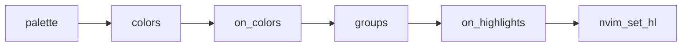

# PR

Every pull request body here follows
[.github/pull_request_template.md](../../../.github/pull_request_template.md).
Read it, fill each section as below, and delete its HTML comments. Keep the
`Before merging` checklist, ticking only what is true.

Skip preambles and keep prose brief. Use the words the code uses: palette,
semantic color, group, link, capture, integration. Write in English, whatever
language the request came in. Add no "Generated with" line or other
attribution, for the same reason [AGENTS.md](../../../AGENTS.md) forbids a
co-author trailer in a commit.

## Summary

Pick the smallest view that makes the key point clear, and put a line of why
beside it. Link the issue with `Closes #N`, or `Related: #N` when the issue
stays open after this pull request.

- A color change as a `diff` of the palette or the semantic layer:

```diff
 c.syntax = {
-	property = c.niagara_dark,
+	property = c.niagara,
```

- Groups that moved as a table of resolved values:

```text
group              before    after
@variable.member   #96a6c8   #96a6c8
@property          #565f73   #96a6c8
```

- File responsibility or a broad refactor as a shallow file tree:

```text
lua/gruber-darker-renaissance/
├── palette.lua   # raw colors
├── colors.lua    # semantic colors
└── groups/       # highlight groups
```

- Data flow with Mermaid:



- The whole block when most of it is new, when omitted context would hide
  ownership or order, or when the reader needs a copyable target shape.

Place each visual next to the short text it supports. Keep only the groups,
colors and files needed to make the point. One view is usually enough, several
are sometimes needed, all of them never are.

## Evidence

Concrete evidence the change works: a before and an after.

- Screenshots of the same buffer before and after are S-tier when the change
  is visible; describe it in text when a screenshot is not to hand.
- Resolved values from `nvim_get_hl(0, { name = ..., link = false })` for the
  groups that moved are A-tier.
- `make check` green is the floor, not evidence. Say it only in the checklist.

## Merge Danger

**Door:** `one-way` or `two-way`. A two-way door is cheap to walk back. Here
the usual one-way doors are an option renamed or removed, a group name users
link to in their own config, and the colorscheme or module name.

**Blast Radius:** one word, then a line of what could break and for whom:
every buffer, one filetype, one plugin, transparent mode, the user's
`on_highlights`.
