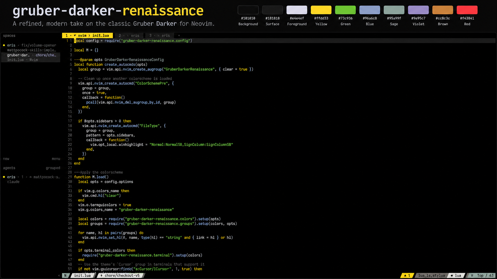

# gruber-darker-renaissance

_A dark, minimal Neovim colorscheme in the spirit of gruber-darker_



Pure black background, near-white names, and one shade per hue: yellow for
keywords, green for strings, niagara blue for functions, quartz for types and
constants, and a warm ash gray for comments. Accents are balanced in lightness
and saturation so no single color shouts.

Requires Neovim 0.10 or newer. No dependencies and no build step.

## Installation

### [lazy.nvim](https://github.com/folke/lazy.nvim)

```lua
{
  "kryptamine/gruber-darker-renaissance",
  lazy = false,
  priority = 1000,
  config = function()
    require("gruber-darker-renaissance").setup({})
    vim.cmd.colorscheme("gruber-darker-renaissance")
  end,
}
```

### Without a plugin manager

```lua
vim.pack.add({ "https://github.com/kryptamine/gruber-darker-renaissance" })
vim.cmd.colorscheme("gruber-darker-renaissance")
```

`vim.pack` needs Neovim 0.12; on older versions clone the repository into a
`pack/*/start/` directory on your `packpath`.

## Configuration

Call `setup()` before loading the colorscheme. Options are merged with the defaults.

### Defaults

```lua
require("gruber-darker-renaissance").setup({
  bold = true,
  italic = {
    strings = true,
    comments = true,
    operators = false,
    folds = true,
  },
  invert = {
    signs = false,
    tabline = false,
    visual = false,
  },
  undercurl = true,
  underline = true,
  transparent = false, -- don't set background colors
  terminal_colors = true, -- set `g:terminal_color_*`
  sidebars = { "qf", "help" }, -- filetypes with the darker sidebar background
  plugins = {
    blink = true,
    cmp = true,
    dap_ui = true,
    dashboard = true,
    fff = true,
    flash = true,
    fzf = true,
    gitsigns = true,
    illuminate = true,
    indent_blankline = true,
    lazy = true,
    leap = true,
    mason = true,
    mini = true,
    mini_icons = true,
    multicursor = true,
    navic = true,
    neo_tree = true,
    neogit = true,
    noice = true,
    notify = true,
    nvim_tree = true,
    rainbow_delimiters = true,
    render_markdown = true,
    snacks = true,
    telescope = true,
    todo_comments = true,
    treesitter_context = true,
    trouble = true,
    which_key = true,
  },
  ---@param colors GruberDarkerRenaissanceColors
  on_colors = function(colors) end,
  ---@param highlights table<string, vim.api.keyset.highlight|string>
  ---@param colors GruberDarkerRenaissanceColors
  on_highlights = function(highlights, colors) end,
})
```

### Overriding colors and highlights

```lua
require("gruber-darker-renaissance").setup({
  on_colors = function(c)
    c.syntax.keyword = c.red
  end,
  on_highlights = function(hl, c)
    hl.FzfLuaTitle = { fg = c.black, bg = c.green }
    hl.FzfLuaDirPart = "Comment" -- a string value is a link
  end,
})
```

`c` holds the raw palette (`c.yellow`, `c.niagara`, `c.ash`) and the semantic
colors built from it (`c.syntax.*`, `c.diag.*`, `c.git.*`, `c.bg_float`); see
[palette.lua](lua/gruber-darker-renaissance/palette.lua) and
[colors.lua](lua/gruber-darker-renaissance/colors.lua).

### Plugins

Highlights are included for
[blink.cmp](https://github.com/saghen/blink.cmp),
[dashboard-nvim](https://github.com/nvimdev/dashboard-nvim),
[fff.nvim](https://github.com/dmtrKovalenko/fff.nvim),
[flash.nvim](https://github.com/folke/flash.nvim),
[fzf-lua](https://github.com/ibhagwan/fzf-lua),
[gitsigns.nvim](https://github.com/lewis6991/gitsigns.nvim),
[indent-blankline.nvim](https://github.com/lukas-reineke/indent-blankline.nvim),
[lazy.nvim](https://github.com/folke/lazy.nvim),
[leap.nvim](https://codeberg.org/andyg/leap.nvim),
[mason.nvim](https://github.com/mason-org/mason.nvim),
[mini.icons](https://github.com/nvim-mini/mini.icons),
[mini.nvim](https://github.com/nvim-mini/mini.nvim),
[multicursor.nvim](https://github.com/jake-stewart/multicursor.nvim),
[neo-tree.nvim](https://github.com/nvim-neo-tree/neo-tree.nvim),
[neogit](https://github.com/NeogitOrg/neogit),
[noice.nvim](https://github.com/folke/noice.nvim),
[nvim-cmp](https://github.com/hrsh7th/nvim-cmp),
[nvim-dap-ui](https://github.com/rcarriga/nvim-dap-ui),
[nvim-navic](https://github.com/SmiteshP/nvim-navic),
[nvim-notify](https://github.com/rcarriga/nvim-notify),
[nvim-tree.lua](https://github.com/nvim-tree/nvim-tree.lua),
[nvim-treesitter-context](https://github.com/nvim-treesitter/nvim-treesitter-context),
[rainbow-delimiters.nvim](https://github.com/HiPhish/rainbow-delimiters.nvim),
[render-markdown.nvim](https://github.com/MeanderingProgrammer/render-markdown.nvim),
[snacks.nvim](https://github.com/folke/snacks.nvim),
[telescope.nvim](https://github.com/nvim-telescope/telescope.nvim),
[todo-comments.nvim](https://github.com/folke/todo-comments.nvim),
[trouble.nvim](https://github.com/folke/trouble.nvim),
[vim-illuminate](https://github.com/RRethy/vim-illuminate) and
[which-key.nvim](https://github.com/folke/which-key.nvim).
Turn one off with `plugins = { name = false }`.

Floats and the completion menu share the editor's black background, so they
read best with a border: set `vim.o.winborder` or the plugin's own `border`.

## Extras

Themes for other tools, generated from the same palette. They live in
`extras/` of this repository; with lazy.nvim that is
`~/.local/share/nvim/lazy/gruber-darker-renaissance/extras/`.

- **fish** — `extras/fish/gruber-darker-renaissance.theme`: link it into
  `~/.config/fish/themes/` and add `fish_config theme choose
  gruber-darker-renaissance` to `config.fish`.
- **Ghostty** — `extras/ghostty/gruber-darker-renaissance`: link it into
  `~/.config/ghostty/themes/` and set `theme = gruber-darker-renaissance`.
- **herdr** — `extras/herdr/gruber-darker-renaissance.toml`: herdr cannot include
  a file, so paste or template it into `~/.config/herdr/config.toml`.
- **kitty** — `extras/kitty/gruber-darker-renaissance.conf`: link it into
  `~/.config/kitty/themes/` and run `kitten themes`, or `include` it from
  `kitty.conf`.
- **lazygit** — `extras/lazygit/gruber-darker-renaissance.yml`: add it to
  `LG_CONFIG_FILE`, which merges a comma-separated list of config files.

## Structure

```
colors/gruber-darker-renaissance.lua  entry point for :colorscheme
lua/gruber-darker-renaissance/
  init.lua                      setup() / load()
  config.lua                    options and defaults
  palette.lua                   raw palette, the only place a hex value is written
  colors.lua                    semantic colors (ui, syntax, diag, git) built from the palette
  terminal.lua                  :terminal colors, shared with the terminal extras
  extras/                       fish, ghostty, herdr, kitty, lazygit renderers
  groups/
    init.lua                    collects groups, toggles plugins
    editor.lua                  UI (:h highlight-groups)
    syntax.lua                  legacy Vim syntax (:h group-name)
    treesitter.lua              tree-sitter captures
    semantic_tokens.lua         LSP semantic tokens
    diagnostics.lua             vim.diagnostic
    plugins/                    one file per plugin
queries/                        tree-sitter query extensions (;extends)
extras/                         generated themes, see Extras
assets/                         README images
```

## Development

```sh
make check   # stylua, a headless load that fails on an unresolved link, extras
make extras  # regenerate extras/ from the palette
```

To work on the theme from a local clone, point lazy.nvim at it with
`dir = "~/path/to/gruber-darker-renaissance"` instead of the repository name.

Contributor rules are in [AGENTS.md](AGENTS.md).

## Credits

Gruber Darker is a popular, high-contrast dark color scheme originally created
for GNU Emacs by Jason Blevins (adapted from John Gruber’s BBEdit theme).

These repositories were great knowledge sources and their
inspiration helped immensely with the development of this plugin.

- [blazkowolf/gruber-darker.nvim][gruber-darker-nvim]

[gruber-darker-nvim]: https://github.com/blazkowolf/gruber-darker.nvim
